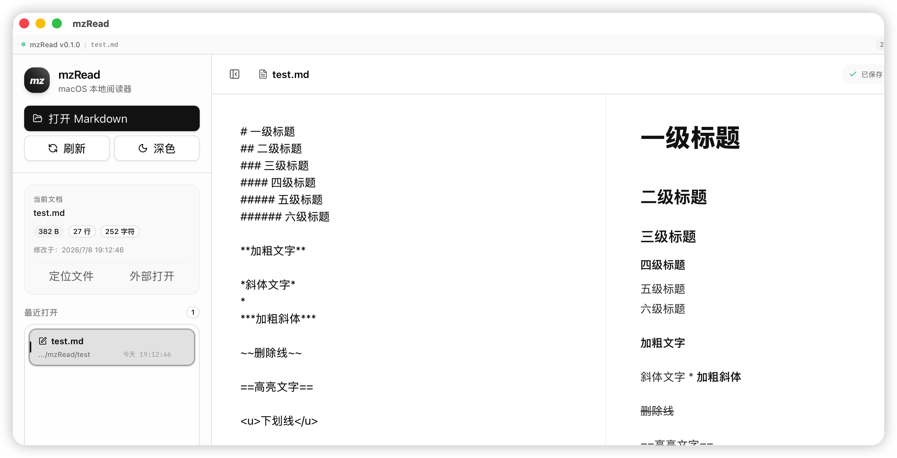

# mzRead

mzRead 是一个面向 macOS 与 Windows 的本地 Markdown 阅读器，基于 Tauri 2、Vue 3 与 Rust 构建。它专注于轻量、快速、安全地打开和阅读本地 Markdown 文档，适合日常笔记、项目文档、说明书与知识库文件浏览。

## 界面预览



## 功能特性

- 打开 `.md`、`.markdown`、`.mdown`、`.mkd` 本地 Markdown 文件
- 使用 Tailwind CSS Typography 提供舒适的阅读排版，支持宽屏与字号缩放 (⌘+/⌘-/⌘0)
- 页内快速全文搜索 (⌘F)，支持实时匹配计数、区分大小写 (Aa) 与居中跳转
- 自动生成文档大纲 (TOC)，支持 H1~H4 层级、章节关键词过滤与滚动自动追踪 (ScrollSpy)
- 代码块右上角自动识别语言标签，支持一键快捷复制
- 正文图片支持点击全屏高清放大预览 (Lightbox) 与缩放旋转
- 使用 DOMPurify 清理 Markdown 渲染后的 HTML，保障浏览安全
- 支持浅色 (Light) / 深色 (Dark) / 羊皮纸护眼暖色 (Sepia) 三色主题自由切换
- 自动记忆文档阅读位置，再次打开无缝恢复
- 支持外部编辑器修改后自动热重载正文 (Live Reload)
- 记录最近打开文件，并支持系统托盘快速访问
- 支持刷新、在系统文件管理器中定位、使用外部应用打开
- 支持 macOS 与 Windows Markdown 文件关联

## 下载

当前发布以下桌面版本：

- `mzRead_0.3.0_macos_arm64.dmg`：适用于 Apple Silicon Mac（M1/M2/M3/M4 等 ARM 架构）
- `mzRead_0.3.0_windows_x64.exe`：适用于 64 位 Windows 10/11

> 说明：当前安装包尚未进行平台代码签名。macOS 可能提示安全限制，Windows 可能显示 SmartScreen 警告；确认下载来源后可按系统提示继续安装。

## 技术栈

- Tauri 2
- Vue 3
- TypeScript
- Rust
- Shadcn Vue
- Tailwind CSS Typography
- markdown-it
- DOMPurify

## 开发环境

建议使用：

- Node.js 24+
- pnpm 11+
- Rust 1.88+
- macOS Apple Silicon，或 Windows 10/11 x64

安装依赖：

```bash
pnpm install
```

启动开发模式：

```bash
pnpm tauri dev
```

## 构建

构建前端：

```bash
pnpm build
```

构建 macOS App 与 DMG：

```bash
pnpm tauri build
```

macOS 构建产物输出位置：

```text
src-tauri/target/release/bundle/macos/mzRead.app
src-tauri/target/release/bundle/dmg/mzRead_0.3.0_aarch64.dmg
```

Windows x64 的 NSIS 安装包由 GitHub Actions 在 `windows-2022` 原生环境构建并随 Release 发布，避免在 macOS 上交叉编译和打包 Windows WebView2 应用。

## 版本

当前版本：`0.3.0`

首版重点是稳定打开、阅读和管理本地 Markdown 文档，后续可继续补充搜索、导出、更多主题、快捷键等能力。
